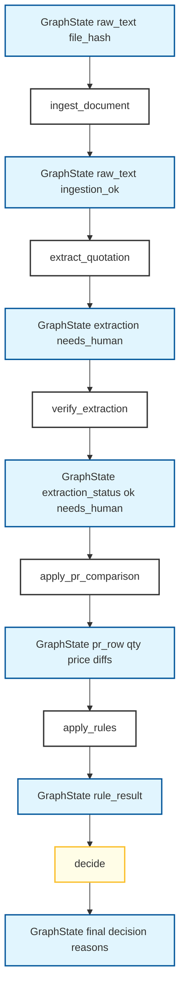
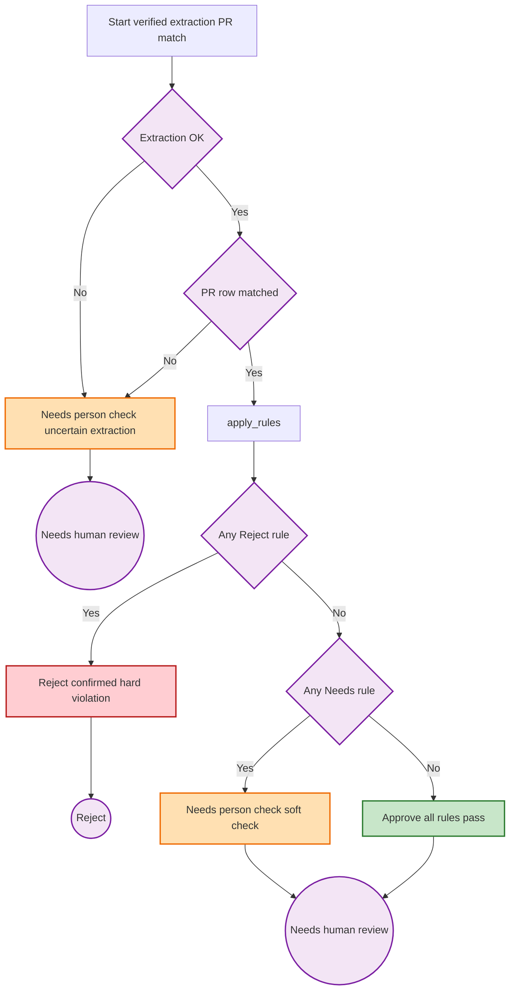
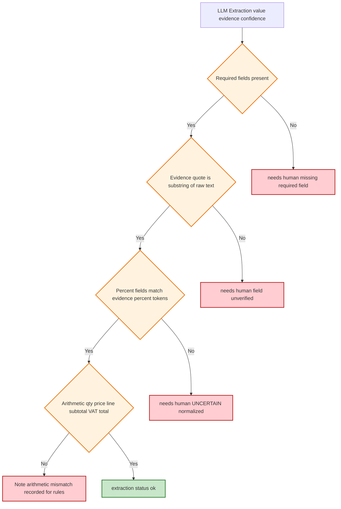
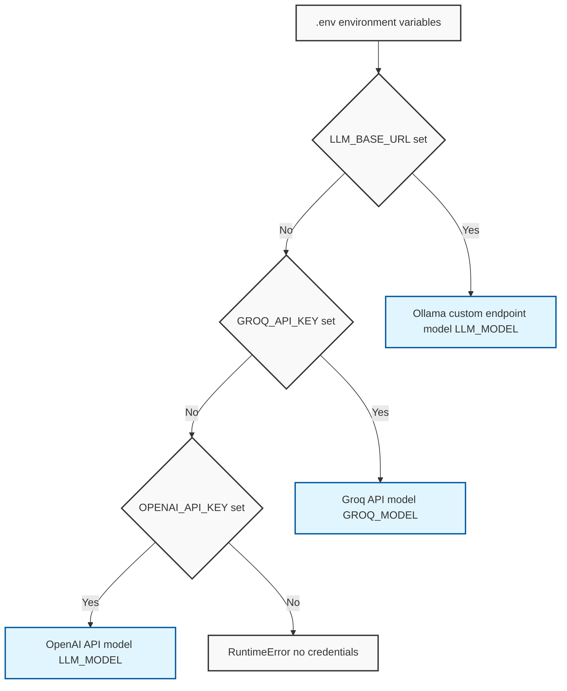
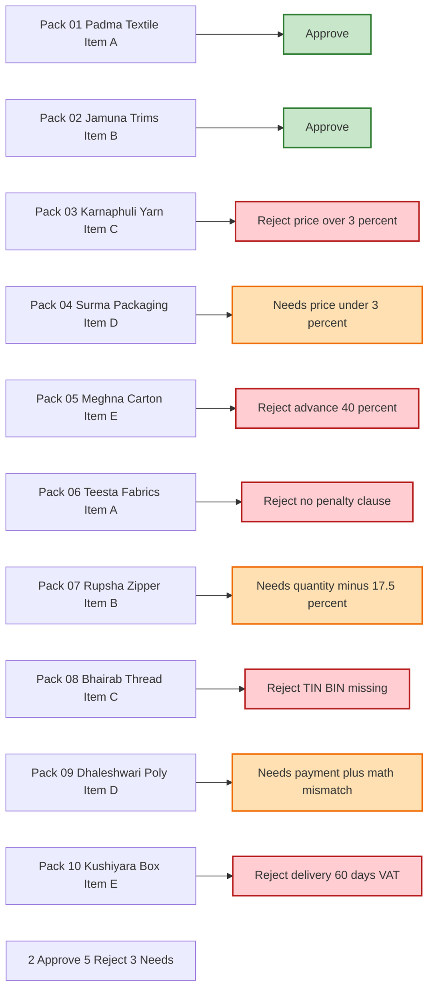

# Architecture & Workflow Diagrams

Mermaid diagrams describing the Supplier Document Checker (Task 1) pipeline,
component layout, decision precedence, and data flow. Copy any `mermaid` block
into a Mermaid-compatible viewer (GitHub, GitLab, Notion, Obsidian, etc.).

---

## 1. High-level pipeline (fixed-step workflow)

```mermaid
flowchart LR
    classDef default fill:#f9f9f9,stroke:#333,stroke-width:2px
    classDef llm fill:#e3f2fd,stroke:#1565c0,stroke-width:2px
    classDef code fill:#e8f5e9,stroke:#2e7d32,stroke-width:2px
    classDef gate fill:#fff3e0,stroke:#ef6c00,stroke-width:2px
    classDef store fill:#f3e5f5,stroke:#7b1fa2,stroke-width:2px

    PDF[("Supplier Pack PDF")]
    INGEST[Ingest Document]
    EXTRACT[Extract Quotation]
    VERIFY[Verify Extraction]
    PR[Load Purchase Request]
    COMPARE[Compare Qty / Price]
    RULES[Apply Company Rules]
    DECIDE[Decide / Precedence]
    AUDIT[JSONL Audit]
    UI[Streamlit UI]

    PDF --> INGEST
    INGEST --> EXTRACT
    EXTRACT --> VERIFY
    VERIFY --> PR
    PR --> COMPARE
    COMPARE --> RULES
    RULES --> DECIDE
    DECIDE --> AUDIT
    AUDIT --> UI

    class EXTRACT llm
    class INGEST,VERIFY,PR,COMPARE,RULES,DECIDE code
    class DECIDE gate
    class AUDIT,UI store
```



**Key principle:** `EXTRACT` is the only LLM node. Every decision (Approve / Reject / Needs a person to check) is made by deterministic Python in `RULES` + `DECIDE`. The LLM never decides.

---

## 2. Node-by-node data flow



---

## 3. Decision precedence (the "never guess" gate)



**Precedence rules:**
1. Ingestion failure / no extraction / no PR match → **Needs a person to check**
2. Confirmed Reject rule → **Reject** (wins over soft extraction uncertainty)
3. Critical extraction uncertainty → **Needs a person to check**
4. Otherwise → rule result (Needs or Approve)

---

## 4. Component layout

```mermaid
flowchart TB
    classDef data fill:#ff9900,stroke:#000,stroke-width:2px,color:#fff
    classDef py fill:#3776ab,stroke:#000,stroke-width:2px,color:#fff
    classDef ui fill:#ff4b4b,stroke:#000,stroke-width:2px,color:#fff
    classDef store fill:#2ecc71,stroke:#000,stroke-width:2px,color:#fff

    subgraph data_layer[Sample Data]
        PR[purchase-request.csv]
        RULES[company-rules.md]
        PACKS[supplier-pack-01..10.pdf]
    end

    subgraph src_layer[src/supplier_check]
        INGEST[ingest.py]
        EXTRACT[extract.py + prompt]
        VERIFY[verify.py + clauses.py]
        PRMOD[pr.py]
        RULES_ENGINE[rules.py]
        DECIDE[decide.py]
        GRAPH[graph.py LangGraph StateGraph]
        STORE[store.py JSONL audit]
        UI[ui.py + control_center]
    end

    subgraph audit_store[Audit Output]
        RUNS[runs timestamp results.jsonl]
        WORKSPACE[workspace live Control Center docs]
    end

    subgraph streamlit[Streamlit UI]
        APP[app.py navigation]
        PAGES[pages Overview New Verification Documents Evaluation Detail]
        COMPS[components HTML tables badges charts]
        CSS[styles.py CSS design tokens]
    end

    PR --> PRMOD
    RULES --> RULES_ENGINE
    PACKS --> INGEST
    INGEST --> EXTRACT
    EXTRACT --> VERIFY
    VERIFY --> PRMOD
    PRMOD --> RULES_ENGINE
    RULES_ENGINE --> DECIDE
    DECIDE --> GRAPH
    GRAPH --> STORE
    STORE --> RUNS
    GRAPH --> UI
    UI --> APP
    APP --> PAGES
    PAGES --> COMPS
    COMPS --> CSS
    WORKSPACE -.-> RUNS

    class data_layer,data data
    class src_layer,py
    class streamlit,ui
    class audit_store,store
```

---

## 5. Verification gates (evidence + arithmetic)



---

## 6. Provider resolution (LLM adapter)



**Precedence:** `LLM_BASE_URL` → `GROQ_API_KEY` → `OPENAI_API_KEY`. Temperature is always `0`.

---

## 7. Golden labels (acceptance target)



---

## How to read these diagrams

- **Fixed steps:** The pipeline is a linear `StateGraph`. There are no tool-calling loops and no autonomous agent.
- **LLM boundary:** The LLM touches data only in the `extract` node. Every business decision is deterministic Python.
- **Audit trail:** Every run writes `runs/<timestamp>/results.jsonl` with the model used, prompt hash, decision, reasons, and evidence quotes.
- **Evaluation:** The Control Center Evaluation page runs the 10 sample packs against locked golden labels in `tests/fixtures/expected.json`.