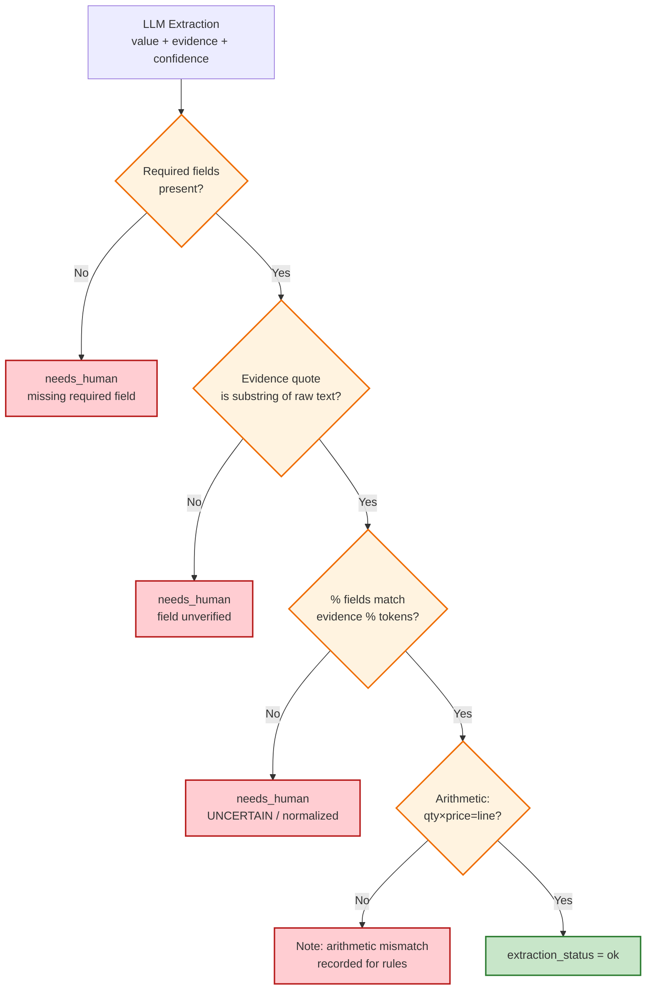
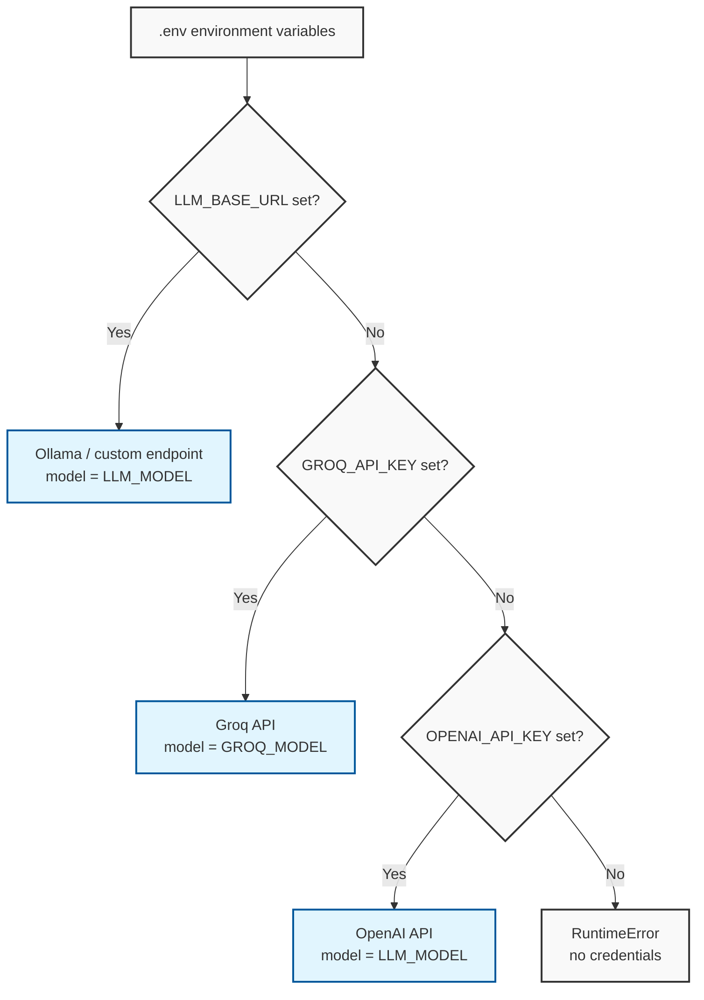
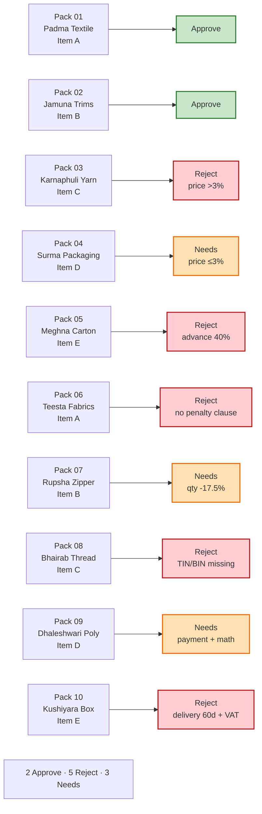

# Architecture & Workflow Diagrams

Mermaid diagrams describing the Supplier Document Checker (Task 1) pipeline,
component layout, decision precedence, and data flow. Copy any `mermaid` block
into a Mermaid-compatible viewer (GitHub, GitLab, Notion, Obsidian, etc.).

---

## 1. High-level pipeline (fixed-step workflow)

```mermaid
flowchart LR
    classDef default fill:#f9f9f9,stroke:#333,stroke-width:2px
    classDef llm fill:#e3f2fd,stroke:#1565c0,stroke-width:2px
    classDef code fill:#e8f5e9,stroke:#2e7d32,stroke-width:2px
    classDef gate fill:#fff3e0,stroke:#ef6c00,stroke-width:2px
    classDef store fill:#f3e5f5,stroke:#7b1fa2,stroke-width:2px

    PDF[("Supplier Pack PDF<br/>one item per pack")]
    INGEST[Ingest Document]
    EXTRACT[Extract Quotation<br/>LLM + JSON schema]
    VERIFY[Verify Extraction<br/>evidence + arithmetic]
    PR[Load Purchase Request<br/>purchase-request.csv]
    COMPARE[Compare Qty / Price]
    RULES[Apply Company Rules<br/>deterministic Python]
    DECIDE[Decide / Precedence]
    AUDIT[JSONL Audit<br/>runs/<timestamp>/]
    UI[Streamlit UI<br/>results + evidence detail]

    PDF --> INGEST
    INGEST --> EXTRACT
    EXTRACT --> VERIFY
    VERIFY --> PR
    PR --> COMPARE
    COMPARE --> RULES
    RULES --> DECIDE
    DECIDE --> AUDIT
    AUDIT --> UI

    class EXTRACT llm
    class INGEST,VERIFY,PR,COMPARE,RULES,DECIDE code
    class DECIDE gate
    class AUDIT,UI store
```



**Key principle:** `EXTRACT` is the only LLM node. Every decision (Approve / Reject / Needs a person to check) is made by deterministic Python in `RULES` + `DECIDE`. The LLM never decides.

---

## 2. Node-by-node data flow

```mermaid
flowchart TD
    classDef state fill:#e1f5fe,stroke:#01579b,stroke-width:2px
    classDef node fill:#fff,stroke:#333,stroke-width:2px
    classDef gate fill:#fffde7,stroke:#fbc02d,stroke-width:2px

    S1[GraphState<br/>raw_text, file_hash]
    N1[ingest_document<br/>PDF → raw_text + sha256]
    S2[GraphState<br/>+ raw_text, ingestion_ok]
    N2[extract_quotation<br/>LLM → QuotationExtraction]
    S3[GraphState<br/>+ extraction (needs_human)]
    N3[verify_extraction<br/>evidence + arithmetic + % reconcile]
    S4[GraphState<br/>+ extraction_status ok/needs_human]
    N4[apply_pr_comparison<br/>load PR row, qty/price diff %]
    S5[GraphState<br/>+ pr_row, qty/price diffs]
    N5[apply_rules<br/>Reject / Needs / Approve]
    S6[GraphState<br/>+ rule_result]
    N6[decide<br/>precedence: Reject beats soft uncertainty]
    S7[GraphState<br/>+ final decision + reasons]

    S1 -->|invoke| N1
    N1 -->|return| S2
    S2 -->|invoke| N2
    N2 -->|return| S3
    S3 -->|invoke| N3
    N3 -->|return| S4
    S4 -->|invoke| N4
    N4 -->|return| S5
    S5 -->|invoke| N5
    N5 -->|return| S6
    S6 -->|invoke| N6
    N6 -->|return| S7

    class S1,S2,S3,S4,S5,S6,S7 state
    class N1,N2,N3,N4,N5,N6 node
    class N6 gate
```

---

## 3. Decision precedence (the "never guess" gate)

```mermaid
flowchart TD
    classDef reject fill:#ffcdd2,stroke:#b71c1c,stroke-width:2px
    classDef needs fill:#ffe0b2,stroke:#ef6c00,stroke-width:2px
    classDef approve fill:#c8e6c9,stroke:#2e7d32,stroke-width:2px
    classDef gate fill:#f3e5f5,stroke:#7b1fa2,stroke-width:2px

    START[Start: verified extraction + PR match] --> G1{Extraction OK?}
    G1 -- No --> N1[Needs a person to check<br/>uncertain extraction]
    G1 -- Yes --> G2{PR row matched?}
    G2 -- No --> N1
    G2 -- Yes --> R[apply_rules()]

    R --> G3{Any Reject rule?}
    G3 -- Yes --> R1[Reject<br/>confirmed hard violation]
    G3 -- No --> G4{Any Needs rule?}
    G4 -- Yes --> N2[Needs a person to check<br/>soft check / uncertainty]
    G4 -- No --> A[Approve<br/>all rules pass]

    G1 -->|extract failed| G2
    N1 --> END1((Needs human review))
    R1 --> END2((Reject))
    N2 --> END3((Needs human review))
    A --> END3

    class G1,G2,G3,G4 gate
    class R1 reject
    class N1,N2 needs
    class A approve
    class END1,END2,END3 gate
```

**Precedence rules:**
1. Ingestion failure / no extraction / no PR match → **Needs a person to check**
2. Confirmed Reject rule → **Reject** (wins over soft uncertainty — D18)
3. Critical extraction uncertainty → **Needs a person to check**
4. Otherwise → rule result (Needs or Approve)

---

## 4. Component layout

```mermaid
flowchart TB
    classDef py fill:#3776ab,stroke:#000,stroke-width:2px,color:#fff
    classDef data fill:#ff9900,stroke:#000,stroke-width:2px,color:#fff
    classDef ui fill:#ff4b4b,stroke:#000,stroke-width:2px,color:#fff
    classDef store fill:#2ecc71,stroke:#000,stroke-width:2px,color:#fff

    subgraph data_layer[Sample Data]
        PR[purchase-request.csv]
        RULES[company-rules.md]
        PACKS[supplier-pack-01..10.pdf]
    end

    subgraph src_layer[src/supplier_check/]
        INGEST[ingest.py]
        EXTRACT[extract.py + prompt]
        VERIFY[verify.py + clauses.py]
        PRMOD[pr.py]
        RULES_ENGINE[rules.py]
        DECIDE[decide.py]
        GRAPH[graph.py - LangGraph StateGraph]
        STORE[store.py - JSONL audit]
        UI[ui.py + control_center/]
    end

    subgraph audit_store[Audit / Output]
        RUNS[runs/<timestamp>/results.jsonl]
        WORKSPACE[workspace/live/ - Control Center docs]
    end

    subgraph streamlit[Streamlit UI]
        APP[app.py - navigation]
        PAGES[pages: Overview / New Verification /<br/>Documents / Evaluation / Detail]
        COMPS[components: HTML tables, badges, charts]
        CSS[styles.py - CSS design tokens]
    end

    PR --> PRMOD
    RULES --> RULES_ENGINE
    PACKS --> INGEST
    INGEST --> EXTRACT
    EXTRACT --> VERIFY
    VERIFY --> PRMOD
    PRMOD --> RULES_ENGINE
    RULES_ENGINE --> DECIDE
    DECIDE --> GRAPH
    GRAPH --> STORE
    STORE --> RUNS
    GRAPH --> UI
    UI --> APP
    APP --> PAGES
    PAGES --> COMPS
    COMPS --> CSS
    WORKSPACE -.-> RUNS

    class data_layer,data data
    class src_layer,py
    class streamlit,ui
    class audit_store,store
```

---

## 5. Verification gates (evidence + arithmetic)



---

## 6. Provider resolution (LLM adapter)



**Precedence:** `LLM_BASE_URL` → `GROQ_API_KEY` → `OPENAI_API_KEY`. Temperature is always `0`.

---

## 7. Golden labels (acceptance target)



---

## How to read these diagrams

- **Fixed steps:** The pipeline is a linear `StateGraph`. There are no tool-calling loops and no autonomous agent.
- **LLM boundary:** The LLM touches data only in the `extract` node. Every business decision is deterministic Python.
- **Audit trail:** Every run writes `runs/<timestamp>/results.jsonl` with the model used, prompt hash, decision, reasons, and evidence quotes.
- **Evaluation:** The Control Center Evaluation page runs the 10 sample packs against locked golden labels in `tests/fixtures/expected.json`.